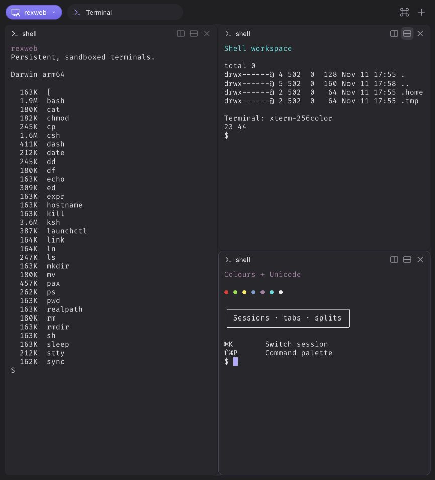

# rexweb



This is an experiment of mine to understand the [Rex](https://www.superlogical.com) terminal multiplexer terminal and provide persistent, sandboxed terminal sessions with a Go server and a browser client built from my [`webterm`](https://github.com/rcarmo/webterm) components and [`ghostty-web`](https://github.com/rcarmo/ghostty-web).

Like Rex, you can manage sessions, tabs and nested splits in a Rex-inspired interface. Resize panes live, switch sessions with **⌘K / Ctrl+K**, and open the command palette with **⇧⌘P / Ctrl+Shift+P** in a web UI that follows the system's light or dark appearance.

The server currently runs on MacOS, and shell isolation requires `/usr/bin/sandbox-exec`. Its supported protocol subset is described in [SPEC.md](SPEC.md#connect-rex-betaapp), and of course, this project is independent of Superlogical Rex (I'm just a fan, but I prefer web interfaces, which is why I based most of this off of [`webterm`](https://github.com/rcarmo/webterm)).

## Build from source

For now, build and run locally on macOS. Install Go 1.24 or later, Bun 1.3.13 or later, Git and `make` (available with Xcode Command Line Tools), then clone the repository:

```sh
git clone https://github.com/rcarmo/rexweb.git
cd rexweb
make install-dev
make build
bin/rexweb
```

Open [http://127.0.0.1:8080](http://127.0.0.1:8080). The server starts or reconnects to the session daemon and creates a default shell when the daemon has no sessions.

Bun downloads my pinned [`ghostty-web`](https://github.com/rcarmo/ghostty-web) fork, including its compiled JavaScript and WASM, and just vendors it in.

## Binary releases

CI is disabled until we can ship to Linux. Once CI and release publishing are working, you'll be able to download a binary archive for your platform from [GitHub Releases](https://github.com/rcarmo/rexweb/releases), verify its SHA-256 digest against `SHA256SUMS`, extract it and run `bin/rexweb` from the extracted directory. The archive will include the frontend, so running it will need neither Go nor Bun.

Keep the archive's directory structure intact. The default `-web-dir web/dist` is relative to the working directory. To launch from another directory, supply an absolute `-web-dir` path. The current macOS packaging produces unsigned binaries that are not notarised.

## Sessions and isolation

Since I abhor running local agents but had to test this alongside the official Rex Beta, I had to sandbox it and each shell starts in a private workspace outside your account home. `HOME` and `TMPDIR` point inside that workspace. The macOS sandbox blocks outbound networking and file contents outside the workspace and permitted system paths. Startup verifies isolation before accepting sessions. See [SECURITY.md](SECURITY.md) for the trust boundary.

Right now, the gateway and daemon are separate processes. Stopping the gateway leaves sessions running; reopening it reconnects to the same daemon. Stopping the daemon ends its shells. Layout and retained output live in daemon memory, with up to 512 KiB of recent output per pane. Workspace files persist until you remove them; the default location is temporary storage.

In the future, I hope to turn this into a Linux-only server, since for me the value of Rex is not so much having a good native desktop terminal but a decent way to manage sessions and reconnect to them (so besides Web I'm also thinking about `mosh`, but that's just wishful thinking right now).

Options that affect shell creation apply when a new daemon starts:

```sh
# Use zsh in an existing private directory outside the account home.
bin/rexweb -shell /bin/zsh -workspace /private/tmp/my-terminal-workspace

# Use an independent daemon and workspace.
mkdir -m 700 /private/tmp/my-rexweb-run
bin/rexweb -session-socket /private/tmp/my-rexweb-run/session.sock
```

* For a daemon managed in the foreground, run `bin/rexweb -serve-sessions` in a separate terminal, then launch the gateway. Give both commands the same absolute `-session-socket` path when overriding it. Stop a foreground daemon with Ctrl-C. 
* For an automatically started daemon, find the PID holding `daemon.lock` beside its socket and send SIGTERM to that PID. On macOS the default directory is `$HOME/Library/Caches/rexweb`; inspect `daemon.log` there for its workspace path. Confirm the socket path before stopping a daemon, since doing so ends its sessions.

Run `bin/rexweb -help` for options and `bin/rexweb -version` for build information. The web UI uses port **8080**. The optional native Rex endpoint that I am using for interop testing uses a separate port, conventionally **7297**, and does not serve the web UI.

## Native Rex client

To enable native clients when starting a new daemon:

```sh
bin/rexweb -rex-listen 127.0.0.1:7297
```

The Rex endpoint is loopback-only, disabled by default, and unauthenticated. See [SPEC.md](SPEC.md) for protocol and retention details.

Add `http://127.0.0.1:7297` as a remote host in Rex Beta.app. Compatibility was tested against Rex `0.1.0-preview.14`, app build 1925, control API revision 12. Sessions, tabs, tiled splits and terminal streaming work within that subset. Each pane supports one live viewer at a time.

Native stream resume, floating panes, Lua configuration, remote authentication and the full automation API are unsupported, and quite honestly do very little for me, so I am unlikely to pursue the entire feature set.

Also, paste RPC isn't working.

## Development and releases

```sh
make build       # Go executable and browser bundle
make test        # Go and frontend unit tests
make check       # TypeScript, layout tests, go vet and Go tests
make race        # Go race detector
make smoke       # Sandboxed PTYs, reconnects, native protocol and daemon startup
make release     # Both macOS archives, checksums and an extracted-package smoke test
make clean       # Remove build and release output
```

`make release` builds local archives in `dist/` using [VERSION](VERSION). See [RELEASING.md](RELEASING.md) for the planned GitHub draft-release workflow and [CONTRIBUTING.md](CONTRIBUTING.md) for change guidelines.

## Licence

Project code is under the [MIT licence](LICENSE), copyright 2026 Rui Carmo. Bundled dependencies and fonts retain their respective licences. [THIRD_PARTY_NOTICES.md](THIRD_PARTY_NOTICES.md) records their sources and notices; copies are included in release archives and the built frontend.
